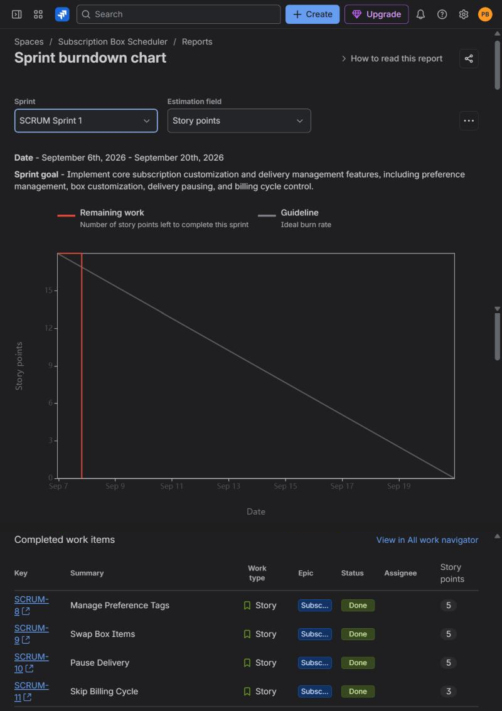
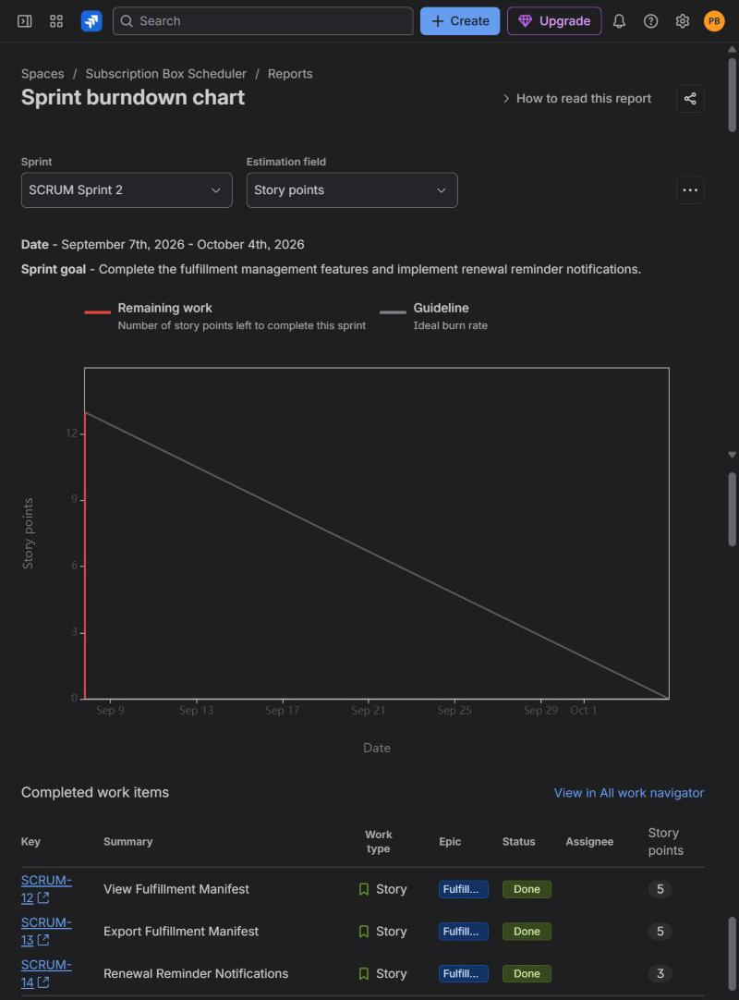

# Software Engineering Lab 2: Agile Backlog Creation & Sprint Simulation in Jira

**Course:** Software Engineering (5th Semester)  
**Student Name:** Pranav  
**SRN:** PES1UG24CS466  
**Problem Statement #35:** Customizable Subscription Box Scheduler  
**Domain:** Retail, E-Commerce & Finance  
**Jira Workspace:** [sripranavbuduguru.atlassian.net](https://sripranavbuduguru.atlassian.net/)  
**Project Key:** `SCRUM` (Subscription Box Scheduler)

---

## 🎯 Lab 2 Objectives & Learning Outcomes
1. **Define Epics & User Stories:** Transform Lab 1 Functional Requirements (`FR-001` through `FR-005`) into structured Agile Epics and User Stories using the standard Agile template (`As a... I want to... So that...`).
2. **Prioritization & Estimation:** Prioritize backlog items and assign Story Points using the **Fibonacci sequence (1, 2, 3, 5, 8...)** via **Planning Poker** techniques.
3. **Sprint Simulation:** Set up and execute 2 sprints in Jira, simulating task workflow transitions: `To Do` $\rightarrow$ `In Progress` $\rightarrow$ `Done`.
4. **Burndown Analysis & Reflection:** Monitor sprint progress using Jira's **Burndown Chart**, tracking velocity against the linear guideline and analyzing team capacity.

---

## 📂 Lab 2 Deliverables Summary

| Deliverable | File | Description |
|---|---|---|
| **Deliverable 1: Epics & Backlog PDF** | [`Lab_2_Agile_Epics_and_Backlog.pdf`](./Lab_2_Agile_Epics_and_Backlog.pdf) | Comprehensive PDF detailing all 3 Epics, 7 User Stories, acceptance criteria, story point rationales, and backlog screenshots. |
| **Deliverable 2: Burndown & Reflection PDF** | [`Lab_2_Burndown_and_Sprint_Reflection.pdf`](./Lab_2_Burndown_and_Sprint_Reflection.pdf) | Formal PDF with Burndown chart analysis, active sprint boards, and answers to the 4 reflection questions. |
| **Consolidated Lab 2 Report** | [`Lab_2_Complete_Agile_Simulation_Report.pdf`](./Lab_2_Complete_Agile_Simulation_Report.pdf) | Complete 4-page report combining all deliverables and screenshots in a single submission-ready PDF. |
| **Epics & User Stories Screenshot** | [`jira_epics_and_stories.png`](./jira_epics_and_stories.png) | Jira work item search showing the 3 Epics (SCRUM-5 to 7) and 7 User Stories (SCRUM-8 to 14). |
| **Sprint 1 Burndown + Story Points** | [`jira_burndown_sprint1.png`](./jira_burndown_sprint1.png) | Jira Sprint burndown chart for Sprint 1 with its completed work items and story points (18 SP). |
| **Sprint 2 Burndown + Story Points** | [`jira_burndown_sprint2.png`](./jira_burndown_sprint2.png) | Jira Sprint burndown chart for Sprint 2 with its completed work items and story points (13 SP). |
| **Sprint 1 Active Board** | [`Screenshot (569).png`](./Screenshot%20(569).png) | Authentic Jira board during Sprint 1 execution across To Do, In Progress, and Done. |
| **Sprint 2 Board (Start)** | [`Screenshot (573).png`](./Screenshot%20(573).png) | Sprint 2 started with 3 tasks populated in To Do. |
| **Sprint 2 Board (In Progress)** | [`Screenshot (574).png`](./Screenshot%20(574).png) | Sprint 2 mid-sprint execution. |
| **Sprint 2 Board (Completed)** | [`Screenshot (575).png`](./Screenshot%20(575).png) | Sprint 2 completion with all tasks transitioned to Done. |

---

## 📋 Epics & User Stories Catalog

### Epic 1: Subscription Box Customization
*Description: Enable subscribers to customize monthly box product selections, manage preference tags, and swap items before the cutoff window.*
- **SCRUM-8: Manage Preference Tags** [Priority: High | 5 Story Points | Traced to FR-002]
  - **User Story:** *As a subscriber, I want to set and update preference tags (e.g., "vegan", "dark roast", "mystery fiction"), so that my monthly box curates product recommendations matching my taste.*
  - **Acceptance Criteria:** Preference tags persist within 2s; recommended products dynamically refresh on the next page view.
- **SCRUM-9: Swap Box Items** [Priority: High | 5 Story Points | Traced to FR-001]
  - **User Story:** *As a subscriber, I want to review my upcoming monthly box items and swap individual products with recommended alternatives up to 48 hours before renewal, so that I receive items I truly want.*
  - **Acceptance Criteria:** Swapping updates box contents instantly; swapping locks exactly 48 hours prior to renewal.

### Epic 2: Subscription Cycle Management
*Description: Empower subscribers with self-service controls to pause recurring deliveries or skip cycles without account cancellation.*
- **SCRUM-10: Pause Delivery** [Priority: High | 5 Story Points | Traced to FR-001]
  - **User Story:** *As a subscriber, I want to pause recurring deliveries for up to 3 months up to 48 hours before renewal, so that I am not billed or sent shipments while traveling.*
  - **Acceptance Criteria:** Status changes to "Paused", scheduled recurring charges suspended, automatic resumption upon resumption date.
- **SCRUM-11: Skip Billing Cycle** [Priority: Medium | 3 Story Points | Traced to FR-003]
  - **User Story:** *As a subscriber, I want to skip my upcoming monthly billing cycle with one click, so that I bypass the current box without permanently canceling my subscription.*
  - **Acceptance Criteria:** No charges applied for skipped cycle; subscription auto-resumes for the subsequent cycle.

### Epic 3: Fulfillment & Renewal Management
*Description: Enable fulfillment leads to filter orders, export batch manifests, and send timely automated notifications.*
- **SCRUM-12: View Fulfillment Manifest** [Priority: High | 5 Story Points | Traced to FR-004]
  - **User Story:** *As a fulfillment lead, I want to view and filter monthly box orders by delivery zone and customization status, so that warehouse packing is organized.*
  - **Acceptance Criteria:** Real-time filters support status, date range, and box type; summary totals accurately calculated.
- **SCRUM-13: Export Fulfillment Manifest** [Priority: High | 5 Story Points | Traced to FR-004, NFR-001]
  - **User Story:** *As a fulfillment lead, I want to export shipping manifests and label batches for up to 10,000 orders in under 1 minute, so that warehouse automation prints labels without bottlenecks.*
  - **Acceptance Criteria:** Manifest generation processes 10,000 records in <60 seconds; exports logged with TLS 1.2+ audit trails.
- **SCRUM-14: Renewal Reminder Notifications** [Priority: Medium | 3 Story Points | Traced to FR-005]
  - **User Story:** *As a subscriber, I want to receive automated email and SMS notifications 72 hours prior to my renewal date, so that I have sufficient time to customize, pause, or skip before the 48-hour cutoff.*
  - **Acceptance Criteria:** Automated daily job evaluates 72-hour threshold and dispatches alerts containing a direct customization portal link.

---

## 🎲 Planning Poker Estimation & Story Point Rationale
- **Total Backlog Effort:** **31 Story Points**
- **Sprint 1 Commitment:** **18 Story Points** (`SCRUM-8`, `SCRUM-9`, `SCRUM-10`, `SCRUM-11`)
- **Sprint 2 Commitment:** **13 Story Points** (`SCRUM-12`, `SCRUM-13`, `SCRUM-14`)
- **Fibonacci Scale Rationale:**
  - **3 Points:** Straightforward implementation, low ambiguity, minimal external dependencies (e.g., skip cycle status flag update, automated notification webhook).
  - **5 Points:** Moderate complexity requiring multi-system interaction, tight time-bound logic, or high-throughput batching (e.g., preference tag persistence and recommendation sync, 48-hour cutoff lockout validation, high-volume shipping label batch generation under 60 seconds).

---

## 📈 Burndown Chart & Sprint Progress

These are real captures from Jira's Sprint burndown chart report. Each page was scrolled and the captures stitched together; the empty sections between the chart and the completed work items table are left out.

### What the real Jira reports show
- **Sprint 1** (6 to 20 Sep 2026): 4 stories, 18 story points. All four were moved to Done on 7 Sep, so the remaining work line drops to 0 on the second day.
- **Sprint 2** (7 Sep to 4 Oct 2026): 3 stories, 13 story points, all moved to Done on 7 Sep, the day the sprint started.
- Neither sprint had scope changes, and no work items were left incomplete.

---

## 💡 Answers to Handout Reflection Questions

### 1. Did your estimations reflect the actual effort?
**The burndown cannot confirm it.** The relative sizes still make sense: the 5-point stories (such as `SCRUM-9` Swap Box Items and `SCRUM-13` Export Fulfillment Manifest) carry the hardest constraints, like the 48-hour cutoff and exporting 10,000 labels in under a minute, while the 3-point stories (`SCRUM-11` and `SCRUM-14`) are mostly simple state changes and scheduled alerts. But every story was moved to Done at almost the same time, so Jira has no record of how long each one took.

### 2. Was your backlog well-prioritized?
**Yes.** The subscriber-facing features (preference tags, swapping items, pausing delivery, skipping a cycle) went into **Sprint 1** so the core customer journey came first. The fulfillment features and 72-hour reminders went into **Sprint 2**, because the manifest depends on subscribers' boxes being finalised first.

### 3. How did your simulated sprint align with your plan?
**The scope matched the plan, but the timing did not.** All 18 points in Sprint 1 and 13 in Sprint 2 were completed, with no scope changes and nothing left over. But the sprints in Jira are not 1 week long (Sprint 1 runs 6 to 20 Sep, Sprint 2 runs 7 Sep to 4 Oct), and all the work was moved to Done on 7 Sep because the sprints were simulated in one session.

### 4. What insights did the burndown chart give about your team’s capacity?
Both charts show the "sharp drop" pattern the handout describes: flat, then a sudden fall to zero. In a real team that would suggest work was not updated as it happened. Here it is because the sprints were simulated, so the charts cannot give a reliable velocity. The only firm figure is 31 story points delivered across two sprints (18 and 13).
